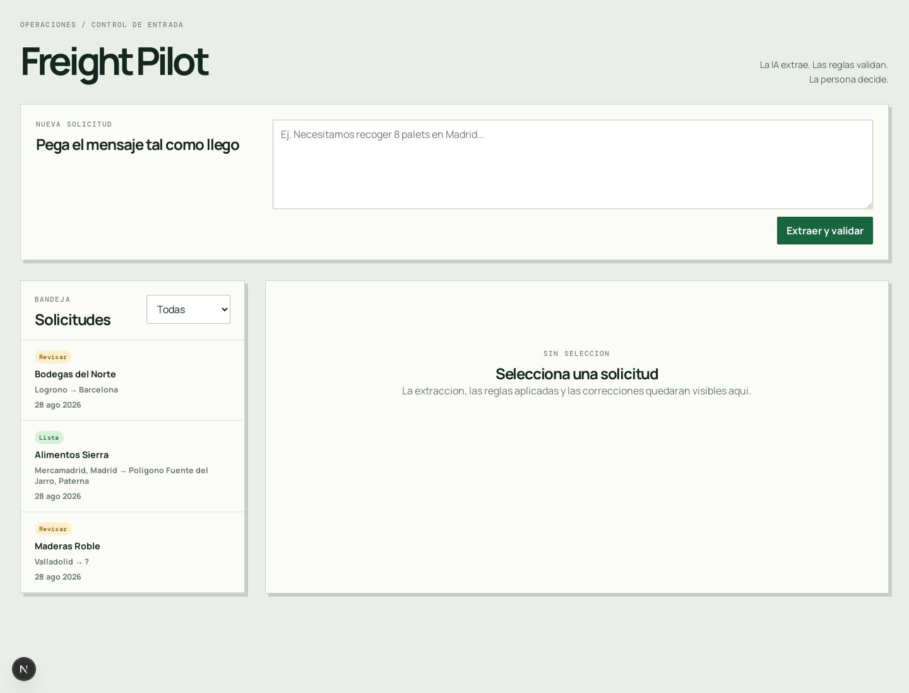
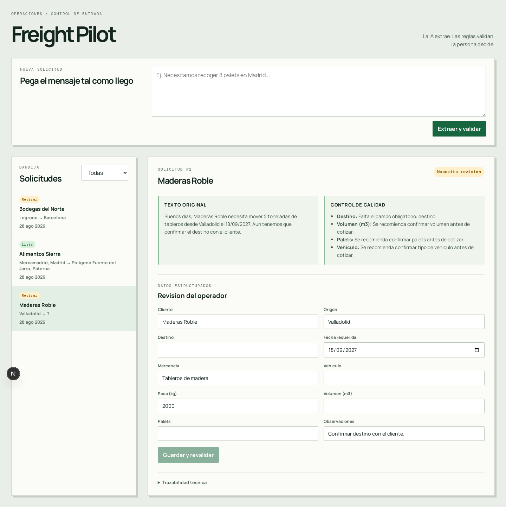
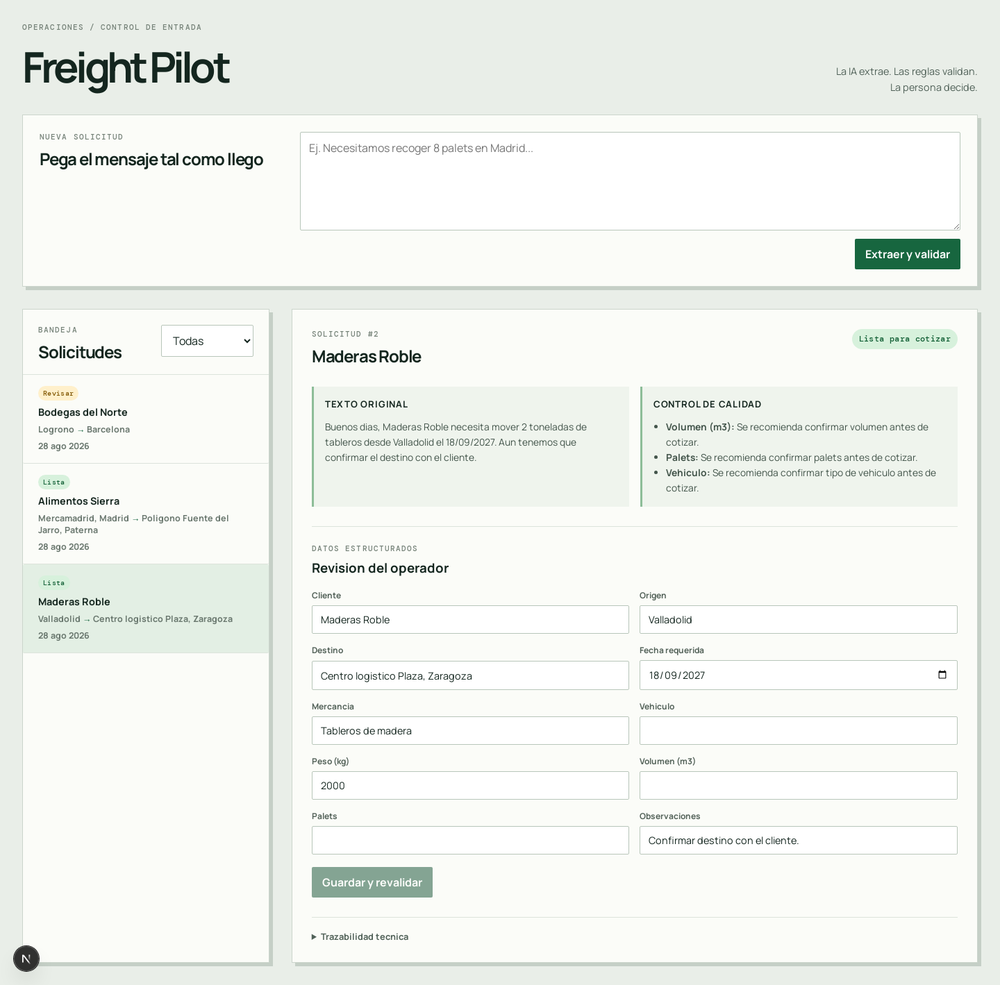

# Freight Pilot

Demo de portfolio para convertir solicitudes de transporte terrestre no estructuradas en solicitudes listas para cotizacion, combinando extraccion LLM, reglas deterministas y revision humana.

El alcance y las decisiones del proyecto estan en [PLAN.md](PLAN.md).

## Requisitos

- Python 3.12+
- [uv](https://docs.astral.sh/uv/)
- Node.js 22+
- Docker Compose

## Arranque local

1. Crear el archivo de entorno: `cp .env.example .env`. No se necesita `frontend/.env.local`: el frontend usa `http://127.0.0.1:8000` por defecto.
2. Para procesar cualquier texto libre con IA, asignar una clave de OpenAI en `.env`: `OPENAI_API_KEY=...`. Sin esa clave solo funcionan los tres casos simulados documentados.
3. Iniciar PostgreSQL: `docker compose up -d postgres`.
4. Instalar dependencias del backend: `uv sync --project backend`.
5. Instalar dependencias del frontend: `npm install --prefix frontend`.
6. Aplicar la migracion: `uv run --directory backend alembic -c alembic.ini upgrade head`.
7. Iniciar la API en una terminal: `uv run --directory backend uvicorn app.main:app --reload`.
8. Iniciar el frontend en otra terminal: `npm run dev --prefix frontend`.

La API queda disponible en `http://127.0.0.1:8000`; comprobarla con `http://127.0.0.1:8000/health`. El frontend queda disponible en `http://localhost:3000`.

## Recorrido de demo

Con la API iniciada, carga los tres casos sin usar el LLM con `curl -X POST http://127.0.0.1:8000/demo/seed`.

En `http://localhost:3000`, el caso de Alimentos Sierra queda listo para cotizar. Maderas Roble requiere un destino y Bodegas del Norte requiere confirmar su fecha. Corrige el destino de Maderas Roble desde el formulario de revision para comprobar que se revalida como `ready_for_quote` y que la correccion queda visible en la trazabilidad.

La siembra es idempotente y restablece los datos originales de los tres casos, por lo que puede ejecutarse antes de cada demostracion.

## Capturas del recorrido

La bandeja muestra el caso listo y los dos que necesitan revision:

Maderas Roble evidencia el destino obligatorio ausente y permite corregirlo:

Tras guardar la correccion, la validacion determinista actualiza el estado a listo para cotizar y conserva la trazabilidad:

## Despliegue en servidor doméstico

La configuración de producción para Docker Compose y Cloudflare Tunnel está en [docs/deployment-home-server.md](docs/deployment-home-server.md). Es independiente del Compose local de PostgreSQL y no reutiliza sus valores de desarrollo.

La demo desplegada es pública y compartida: otros visitantes pueden leer y modificar las solicitudes. El texto introducido se envía a OpenAI. No uses información confidencial. El endpoint público `/demo/seed` puede crear o restablecer los tres casos ficticios.

## Verificacion de la base inicial

- Backend: `uv run --directory backend python -c "from app.main import app; assert app.title == 'Freight Pilot API'"`
- Dominio: `uv run --directory backend pytest`
- Frontend: `npm run build --prefix frontend`
- Base de datos: `docker compose exec postgres pg_isready -U freight_pilot -d freight_pilot`
